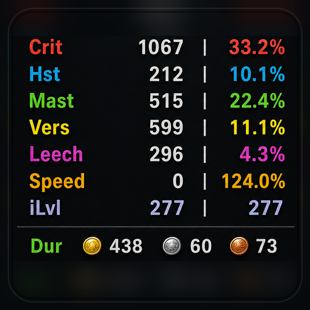
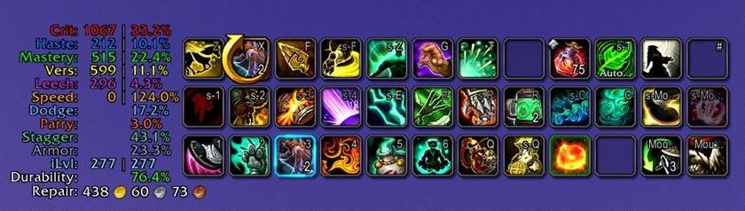
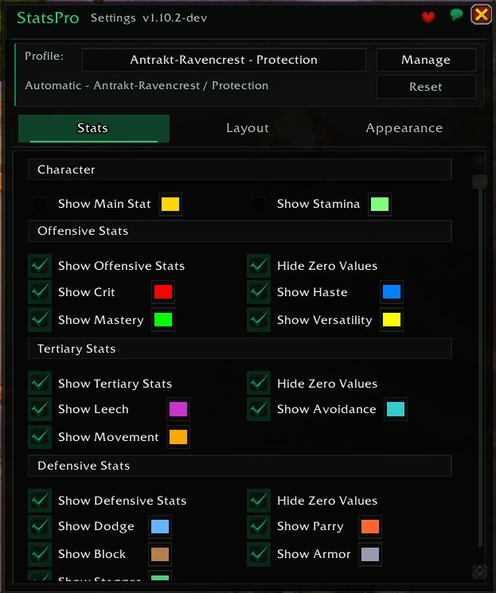
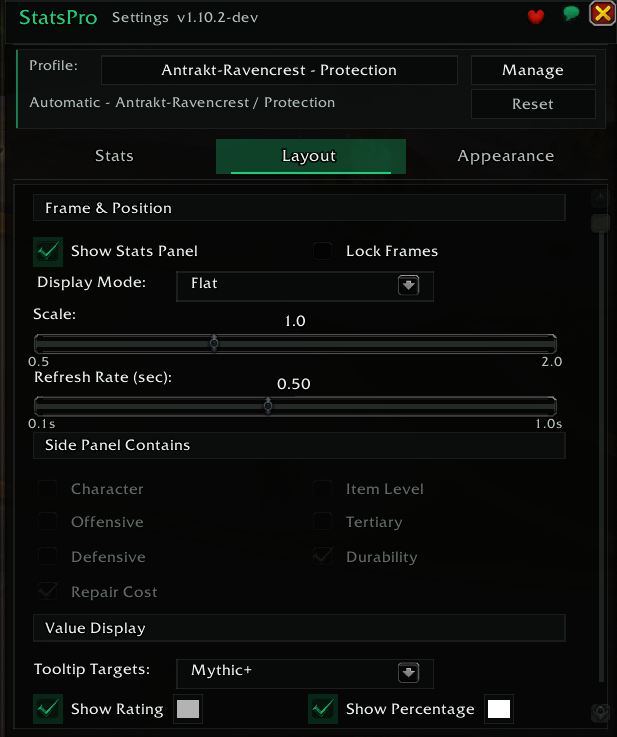
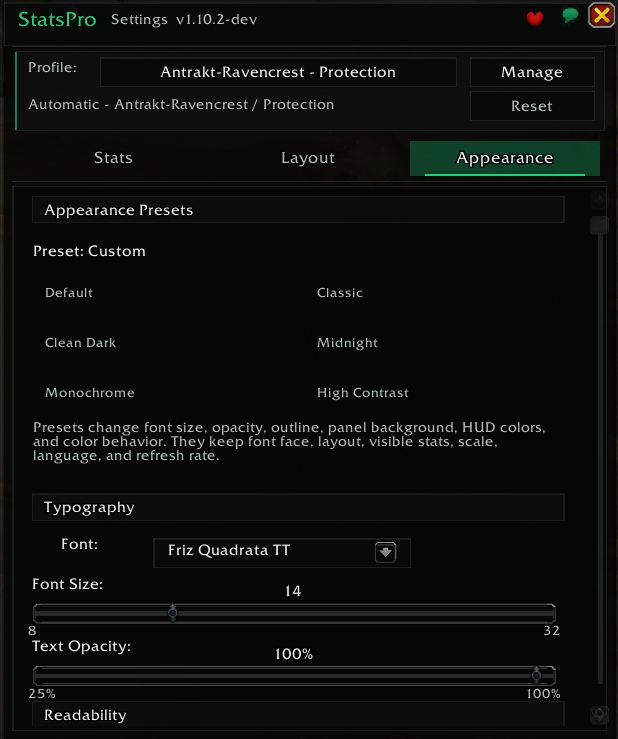
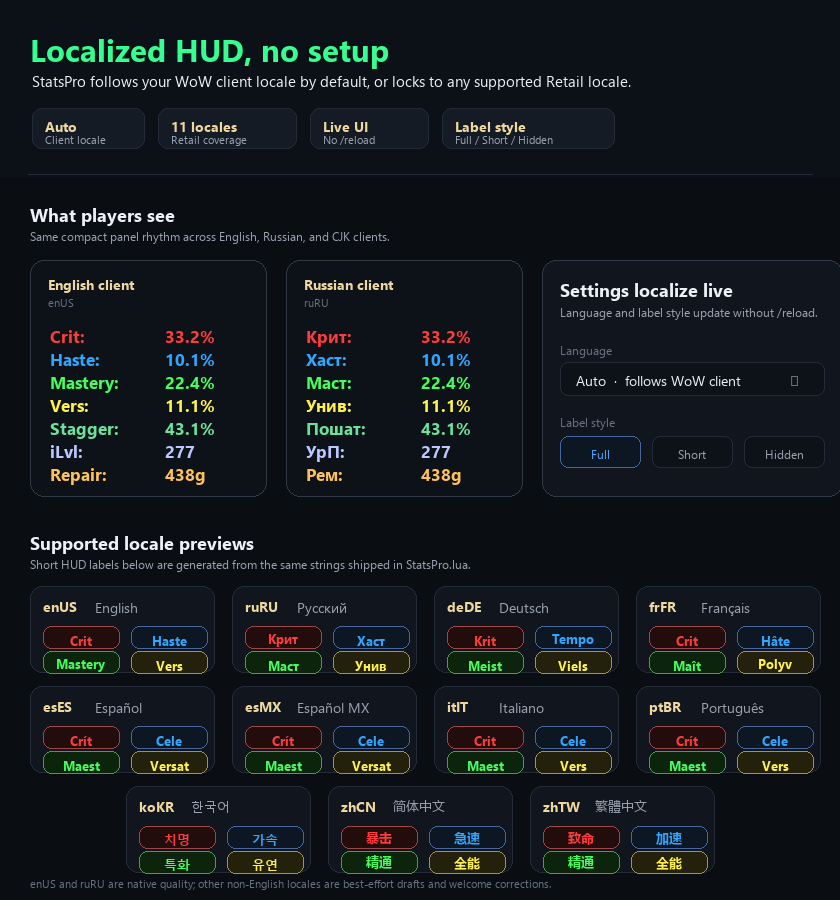

  

<h1 align="center">StatsPro</h1>

  Keep your character stats on screen without opening the Character panel.

  <a href="https://www.curseforge.com/wow/addons/statspro"><strong>CurseForge</strong></a>
  · <a href="https://addons.wago.io/addons/statspro">Wago Addons</a>
  · <a href="https://github.com/Antrakt92/StatsPro/releases">GitHub Releases</a>

  
  
  
  
  

StatsPro is a customizable stats and gear HUD for **World of Warcraft Retail:
Midnight** and the **WoW Forever beta**. Keep the stats you care about beside your
action bars, with optional gear information and settings you can share across
characters.

Retail includes Crit, Haste, Mastery, Versatility and bundled Archon references.
Forever has its own 46-row stat catalog, class-aware setups and per-character
profiles. Archon references are available only in Retail.

*Retained older in-game capture; fresh screenshots pending.*

## Getting started

1. Type `/ss` or `/statspro` to open Settings.
2. Preview a Quick Setup preset, then click **Use this setup**.
   Retail offers **Compact**, **DPS** and **Tank**; Forever offers **Compact**,
   **Physical**, **Caster**, **Healer** and **Tank**.
3. Drag the unlocked panels into place, then lock them in Settings.

Type `/ss` or `/statspro` to open Settings. Outside combat, you can also
right-click the HUD. To choose another setup later, expand **Quick Setup**
at the top of the **Stats** tab or adjust individual rows yourself.

Both builds include 46 font faces: clean, geometric, pixel, handwritten and
classic serif styles, with Cyrillic, Chinese, Japanese and Korean families.
Choose one in **Appearance → Font**; no separate font addon is needed. Fonts
registered by other addons remain available alongside the included collection.
Only fonts compatible with your selected language appear in the list.
Click the star beside a font to keep it at the top of the list. Favorites are
shared across profiles and saved between sessions; hover still previews the HUD.

### Client versions

[Retail: Midnight](https://github.com/Antrakt92/StatsPro/releases/latest)
· [WoW Forever beta](https://github.com/Antrakt92/StatsPro/releases/tag/forever-v1.21.2)

Retail and Forever have separate builds and update independently.
Classic Era and other Classic branches are unsupported.

### Quick Setup

**Retail**

| Setup | What it shows |
|---|---|
| **Compact** | The four secondary stats |
| **DPS** | Secondary and tertiary stats, item level, durability and repair cost |
| **Tank** | The DPS setup with defensive stats added |

**Forever beta**

| Setup | What it shows |
|---|---|
| **Compact** | Essentials for your class |
| **Physical** | Attack power, hit, crit, haste and expertise; ranged stats for Hunters |
| **Caster** | Spell hit, crit, haste and your class's spell schools |
| **Healer** | Healing power, mana regeneration, spell crit and haste |
| **Tank** | Armor, defense, avoidance, melee hit and expertise |

Forever's starting rows follow your class. Hybrid classes can choose a role preset
or select individual rows; presets do not infer your talent build. Applying a
setup keeps your appearance and custom colors.

Click a setup to preview it before applying. Closing the first-login panel or
pressing Escape keeps your current settings; it will not reopen at the next login.
Quick Setup changes rows and layout while keeping your font, colors, scale and
panel positions. It applies to the settings currently in use, including an active
account-wide setup.

## Stats and gear rows

### Retail

| Area | Available rows |
|---|---|
| **Secondary stats** | Crit, Haste, Mastery, Versatility |
| **Character** | Main stat, selected automatically for your specialization; Stamina |
| **Tertiary and movement** | Leech, Avoidance, ground movement speed |
| **Defensive** | Dodge, Parry, Block, Brewmaster Stagger, Armor damage reduction |
| **Gear** | Equipped and overall item level, durability, lowest-durability slot, repair cost |

Every row is optional. Rated stats can show rating, percentage or both. Defensive
rows depend on your class and specialization. Repair cost uses gold, silver and
copper icons.

Movement shows your current ground run speed, including slows, boosts and ground
mounts. Normal speed is about 100%; the value remains meaningful while stationary.

### Forever beta

Choose from **46 optional rows**:

- All five attributes: Strength, Agility, Stamina, Intellect and Spirit.
- Separate melee, ranged and spell crit, hit and haste; melee and ranged attack
  power; expertise, armor penetration and spell penetration.
- Offhand hit, available separately from melee hit on the latest beta client.
- Spell power by school and healing power.
- Armor, defense, Dodge, Parry, Block, block value and school resistances.
- Mana regeneration outside and during casting, per second or per five seconds;
  run speed in yards per second.

Optional item level, durability and repair cost use the same gear controls.
Attributes and stat families have separate editable colors. Short labels keep
combat types, spell schools and resistances distinct; hover a stat checkbox to
read its full name. Some values may show `?` when unavailable or when a compound
value cannot be read safely in combat.

Forever Settings show **Forever Beta** beside the version. Hover a stat checkbox
for its full name and an explanation of unavailable values. Turning a section
off disables its individual controls while keeping your selections.

## Layouts

- **Flat:** a simple list of your chosen rows.
- **Sectioned:** rows grouped under category headings.
- **Split:** two independently movable panels, with selected groups on each.

Panels resize to fit their rows, with rating and percentage columns aligned.
Fresh and reset panels have a transparent background; add a darker backing in
**Appearance** for more contrast. When unlocked, temporary outlines and drag
handles help you position them.

## Profiles and appearance

### One setup for all your characters

StatsPro remembers settings for each character and specialization in Retail,
and for each character in Forever. Forever does not switch profiles automatically
when talents change.

For the same HUD on every alt, open **Profiles & sharing...**, select the setup
you want and choose **Use these settings everywhere...**. This creates an
account-wide copy for all existing and future characters, including Retail
specializations.

**Return to specialization settings...** in Retail, or **Return to character
settings...** in Forever, restores your previous assignments.
The account-wide setup stays saved, so **Use account-wide settings...** can
activate it again later.

### Copy or share a setup

In **Profiles & sharing...**, copy **Stats**, **Layout**, **Appearance** or all
settings from another character or Retail specialization. You can also share one
set of settings between them. **Make this specialization independent...** in
Retail, or **Make this character independent...** in Forever, gives it its own
copy again.

Use **Export / import profile...** to share a profile string with another player.
Imports show a preview and let you choose which sections to use before applying.

Import behavior and saved-settings recovery

Retail strings start with `SPP1:`; Forever strings start with `SPF1:`. Share
strings with players using the same client flavor; cross-flavor imports are
rejected. The import preview shows the profile name, format version and included sections. Unchecked sections inherit your current
settings. Imported sections create a new independent profile for the selected
character or Retail specialization, or a new account-wide copy when that mode
is active.

Existing profiles, other assignments, language and refresh rate are preserved. To display an imported custom font, it must also be installed on
the receiving client; otherwise StatsPro uses a fallback font.

To recover a setup replaced by an import, choose **Advanced → Recover saved
settings...** in the profile tools. Select a saved setup, review the summary and
confirm. Recovery creates a separate copy for the selected character or Retail
specialization, or a new account-wide copy. It keeps the saved source, replaced
setup and other assignments. Recovery is available only when an unused saved
setup exists.

Other **Advanced** tools let you reset current settings, forget an offline
character, choose Tank, Healer and Damage starting settings for new
specializations in Retail, manage the saved account-wide setup or delete unused
profiles. Role-template assignment is hidden in Forever.

### Appearance themes

Adjust fonts, colors and scale yourself, or expand **Appearance Presets** to
preview **Default**, **Classic**, **Clean Dark**, **Midnight**, **Monochrome** or
**High Contrast**. Choose **Apply** to keep a theme or **Cancel preview** to
return to your saved appearance.

Appearance themes change presentation while keeping your chosen stats, layout,
scale and panel positions. They apply to the current character or Retail
specialization's settings, or the active account-wide setup. Settings remembers
your tab and scroll position during the game session.

Settings screenshots — earlier interface version

These screenshots show an earlier version of Settings. Some controls and labels
have changed; use the instructions above for current profile and Quick Setup tools.

## Archon reference snapshots — Retail only

Hover Crit, Haste, Mastery or Versatility to see an **Archon reference rating for
your specialization**, the snapshot date and a comparison with your current
rating when available.

Choose from the available datasets in Settings:

- **Mythic+:** the current key bracket or High Keys, across all dungeons.
- **Raid:** Normal, Heroic or Mythic, across all bosses.

The tooltip shows **Missing**, **Over** or **Matched** against the reference.
If WoW restricts the comparison during combat, cached values are marked
**Last known**. When no safe comparison is available, the reference remains
visible on its own.

**These are reference values, not stat caps or personalized gearing
recommendations.** Use simulations to evaluate upgrades for your own character.

Snapshots ship inside the addon and are not fetched live. Available datasets
depend on your specialization. When an Archon Normal or Heroic page is
unavailable, that spec's affected difficulty stays out of the selector, with no
old ratings or substitute difficulty shown for that selection. Mythic+ current-affix
routes use Archon's rolling 14-day sample. No companion app is required.

## Localization

The HUD, Settings, profile tools and tooltips support all current WoW client
languages in both builds. Leave the language on **Auto** to follow your WoW client, or select
another language in Settings.

Language and refresh rate are account-wide. HUD appearance and visible rows
follow your current character or Retail specialization's settings, or the active
account-wide setup.

View the language preview

## Commands

| Command | Action |
|---|---|
| `/ss` or `/statspro` | Open Settings |
| `/ss show` | Show the HUD |
| `/ss hide` | Hide the HUD |
| `/ss toggle` | Toggle HUD visibility |
| `/ss help` | List available commands |
| `/statspro import` | Import compatible legacy SwiftStats settings into a new character, Retail specialization or account-wide profile |

Diagnostics and reset commands

| Command | Action |
|---|---|
| `/ss selftest` | Collect out-of-combat and combat diagnostic samples, then show a copyable report |
| `/ss selftest all` | Print existing StatsPro, DoYouNeedIt and ApplicantScout report summaries in chat |
| `/ss debug` | Print support information |
| `/ss reset` | Confirm and reset the settings currently in use; the warning identifies affected characters, Retail specializations or account-wide scope |
| `/ss wipe` or `/ss reset all` | Confirm and reset all profiles, assignments, role templates, account settings and saved positions |

Retail and WoW Forever beta use the same commands and aliases.
All commands also work with `/statspro`. Use it if `/ss` conflicts with another
command. To control visibility with a keybind, put `/ss toggle` in a macro and
bind it to a key.

## Moving from SwiftStats

StatsPro carries over compatible SwiftStats settings when both addons are loaded
on your first StatsPro login. If StatsPro has already started:

1. Enable SwiftStats and StatsPro together.
2. Log in and run `/reload`.
3. Run `/statspro import` and confirm.
4. Check the new `SwiftStats Import` profile, then disable or uninstall SwiftStats.

The import creates a new profile for the current character, including its Retail
specialization, or a new account-wide copy when that mode is active. Existing
StatsPro profiles, other assignments, account settings and the original SwiftStats
settings are preserved.

## Compatibility

- **Retail — Midnight:** 12.1.5.
- **WoW Forever beta:** the separate Forever build targets the current beta
  client. Its stat catalog and per-character profiles are designed for that client.
- **Classic Era and other Classic branches:** not supported by either build.

Forever beta updates may change available APIs. For combat-stat problems, run
`/ss selftest` outside combat, fight a creature, then leave combat to collect the
report. `/ss debug live` identifies restricted values without printing them.

## Help, feedback, and development

Open a [GitHub issue](https://github.com/Antrakt92/StatsPro/issues) for bugs,
translation corrections or feature requests. Include your WoW build, StatsPro
version, client flavor (Retail or Forever), class/spec and steps to reproduce the
problem. Add a screenshot for
visual issues. For combat-stat or Archon-tooltip issues, include the output of
`/statspro debug live` from the affected state.

See [`CHANGELOG.md`](CHANGELOG.md) for release history and
[`CONTRIBUTING.md`](CONTRIBUTING.md) for developer setup and verification.

StatsPro is free to use. Optional support is available through
[Ko-fi](https://ko-fi.com/antrakt92) or
[GitHub Sponsors](https://github.com/sponsors/Antrakt92).

## Acknowledgements

- **[@tflo](https://github.com/tflo)** — product and UX feedback across stats,
  layout, settings, labels and gear presentation.
- **[TaylorSay](https://www.curseforge.com/members/taylorsay)** — author of
  [SwiftStats](https://www.curseforge.com/wow/addons/swiftstats), the MIT-licensed
  project that originally inspired StatsPro.
- **[LibSharedMedia-3.0](https://www.curseforge.com/wow/addons/libsharedmedia-3-0)** —
  font selection support.

## More by Antrakt
- [ApplicantScout](https://www.curseforge.com/wow/addons/applicantscout-lfg-overlay) — LFG & Party overlay with WCL and RaiderIO context
- [DoYouNeedIt](https://www.curseforge.com/wow/addons/do-you-need-it) — group loot helper with opt-in whispers

## License

You may modify and share my original work under the [Antrakt Attribution and CurseForge Rewards License 1.4](https://github.com/Antrakt92/StatsPro/blob/main/LICENSE) without asking first. Substantial reuse requires credit, a link to [StatsPro](https://www.curseforge.com/wow/addons/statspro) and a positive share of the derivative project's CurseForge Reward Points if it earns them. You choose the percentage; there is no fixed minimum. See the full license for exceptions and third-party terms.

SwiftStats-derived code remains MIT. [Third-party material](https://github.com/Antrakt92/StatsPro/blob/main/THIRD-PARTY-NOTICES.md) keeps its own terms.
